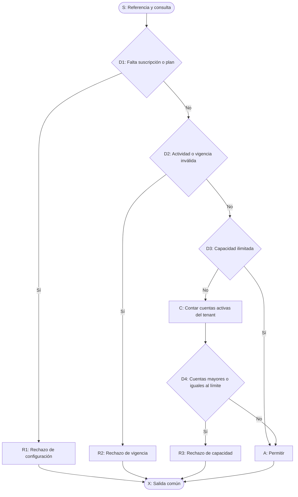
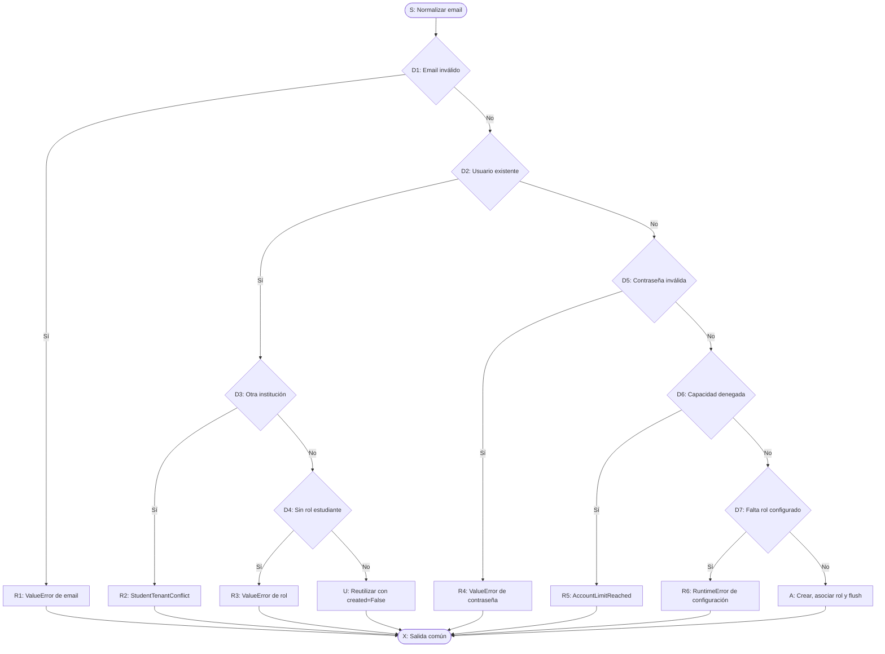
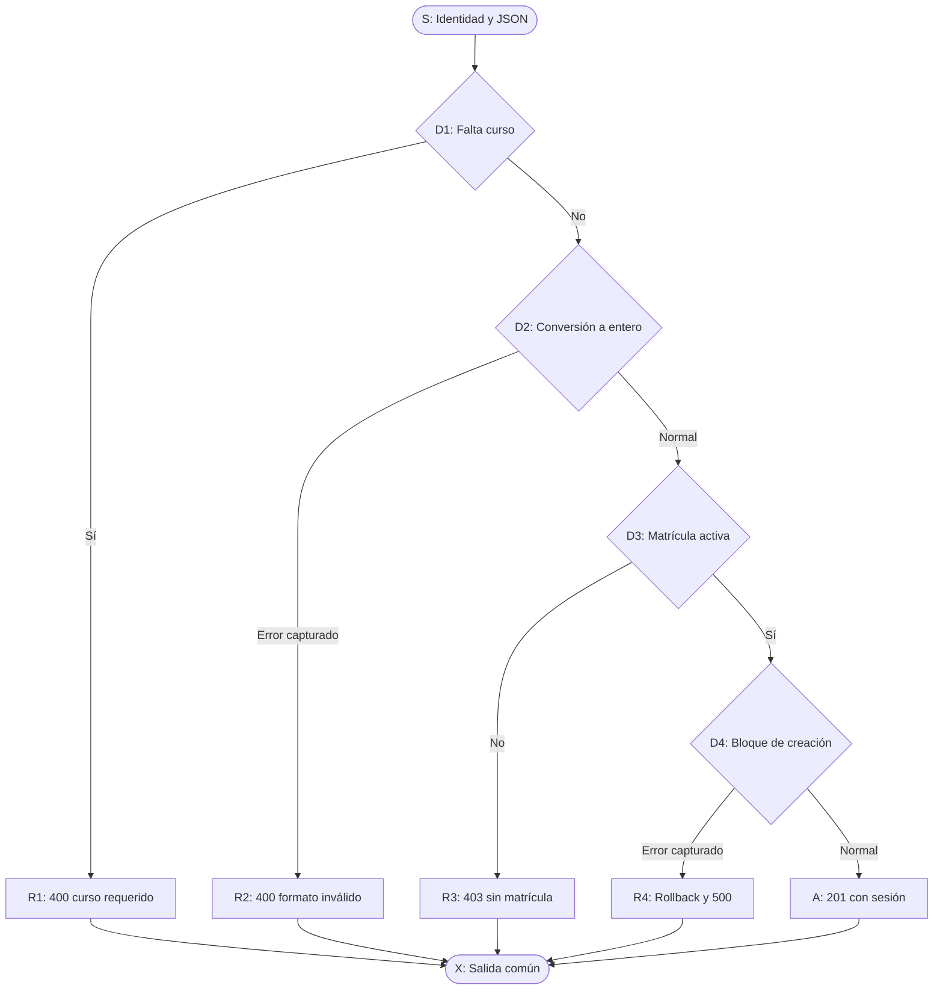

# Registro de pruebas de SPEC-001

## 1. Identificación y alcance

**Referencias:** [spec.md](spec.md), [plan.md](plan.md), [tasks.md](tasks.md) y [Constitución](../constitution.md).  
**Fecha de preparación:** 2026-09-30.  
**Commit de referencia:** `6b7b79bbfdbea5614ffe369330e55905fffe3c98`.  
**Estado:** T1–T24 completadas como trabajo de pruebas y evaluación, no como aprobación íntegra. RF-5 fallido (S-001 abierto, corrección diferida fuera de esta spec); RNF-6 fallido (H-004, mensajes propios en inglés). Sistema S-1/S-3/S-3b aprobado y S-2 fallido; cuatro conjuntos limpiados, Excel eliminado y servidores detenidos. [Evaluación final](evidence.md#evaluación-final-t23t24-2026-09-30), [sistema](evidence.md#sistema-manual-t19t22-2026-09-30), [regresión futura](../../../testing/REGRESSION.md).

Durante la preparación y las ejecuciones de consolidación se registraron cambios locales no incluidos en el commit de referencia. Los reportes conservan ese estado histórico aunque posteriormente se versionen los entregables. La versión realmente evaluada por futuras ejecuciones deberá registrar también los cambios locales relevantes. Las huellas siguientes identifican los archivos fuente revisados, no una ejecución de sus funciones.

| Algoritmo | Fuente revisada | SHA-256 del archivo completo |
|---|---|---|
| A-1 — Capacidad de cuentas | [account_creation_allowed](../../../backend/services/subscription_quota.py#L69-L89) | `FCC29D9860CBFE07D411741037CE85EF006A6CE6058C49423A5DBB5E8CCFCF10` |
| A-2 — Alta/reutilización | [_get_or_create_estudiante](../../../backend/routes/coordinador.py#L131-L173) | `622720AB2BA09B083CCA2558424C70E4DBF68BA0B9D27C36429046977FB05F53` |
| A-3 — Conversación | [create_sesion](../../../backend/routes/estudiante.py#L313-L345) | `F86FA5AA5BE8343774D21A877612AC1CF3CBCC32972A86AF6753D0A17CC1220C` |

Solo se verificará esta lógica y los requisitos de la construcción. Quedan fuera tokens, IA, proveedores, RAG, notificaciones, validadores exhaustivos y el resto del MVP. Las rutas o dependencias que se usen para preparar/acceder al caso no pasan automáticamente a ser objetos de prueba.

### 1.1. Verificación de consolidación documental (2026-10-31)

Se repitieron las suites actuales con Python 3.13.2, sin modificar código de producto ni soporte de pruebas. Cada reporte registra el commit de referencia, los cambios locales y las huellas de sus fuentes:

- Suite aislada: 23 pruebas, cero fallos, errores u omisiones; aislamiento restaurado y código de salida 0.
- Controles simulados: 53 pruebas, cero fallos, errores u omisiones; aislamiento restaurado y código de salida 0.

Resumen de ambas ejecuciones en [evidence.md](evidence.md#suite-aislada-y-controles-simulados).

No se ejecutaron integración SQL ni recorridos de sistema, ni se accedió a proveedores reales. Estas ejecuciones no vuelven a certificar la integración histórica con el soporte actual, no verifican SPEC-002 y no cierran RF-5/S-001 ni RNF-6/H-004. Por decisión del responsable, el 2026-10-31 se retiraron las carpetas de reportes y journals `ownership.json`; [evidence.md](evidence.md) conserva fechas, conteos y resultados originales. Los reportes que generen nuevas ejecuciones son locales y quedan fuera de Git.

## 2. Recursos y reglas de registro

- [Proyecto independiente](../../../testing/README.md), Python 3.13 y unittest; Mermaid para los grafos.
- Aislamiento: dependencias controladas, sin acceso a secretos, SQL o servicios externos. T4–T9 ejecutadas: 23 pruebas satisfactorias, sin omisiones.
- Integración: I-1…I-4 aprobados sobre SQL Server real, RASTONE-PC / Tutoria-demo, tras confirmación expresa. Ocho conjuntos propios limpiados y comprobación posterior de cero residuos. Evidencia en §6.7.
- Sistema: [procedimiento manual](../../../testing/SYSTEM.md) y [soporte optativo](../../../testing/run_system.py), sin publicar bearer tokens. Cuatro casos ejecutados, tres aprobados y S-2 fallido; limpieza verificada. [Seguimiento](evidence.md#sistema-manual-t19t22-2026-09-30). SQL no sustituye observación manual; S-001 no corregido.
- Toda evidencia de ejecución deberá identificar fecha, versión/commit, cambios locales, modalidad, caso/camino, preparación, entrada ficticia, resultado esperado/obtenido, código de salida y limpieza. Los reportes se añadirán a la subcarpeta de evidencias de la ejecución cuando realmente existan.
- Estados: **aprobado**, **fallido**, **no ejecutado**, **no aplicable** con justificación. Una omisión o bloqueo es «no ejecutado», no «no aplicable». Las tareas documentales completadas no aprueban automáticamente los RF funcionales.
- Cada resultado registrado deberá enlazar evidencia real. No incluir URI de conexión, contraseñas, hashes de contraseñas, claves JWT, tokens, datos privados o capturas de autorización.

## 3. Checklist por requisito

Evaluación final T24: diseño/casos separados de evidencia ejecutada y revisión. Aprobaciones acotadas, no certifican todo el MVP. Completar tareas no oculta requisitos fallidos.

| RF/RNF | Referencia prevista | Resultado esperado | Resultado obtenido | Estado | Evidencia de verificación | Defecto pendiente |
|---|---|---|---|---|---|---|
| RF-1 | T1, T4, T8, T9, T24 | Proyecto independiente y aislamiento/restauración comprobados | Entorno propio, aislamiento/restauración y revisión final conformes | aprobado | [T24 y suites](evidence.md#evaluación-final-t23t24-2026-09-30) | Ninguno observado en alcance |
| RF-2 | Grafos/caminos, T24 | Selección esencial justificada y trazabilidad completa | Tres algoritmos, riesgos, caminos/casos y continuidad proporcional vinculados | aprobado | §6 y [T23/T24](evidence.md#evaluación-final-t23t24-2026-09-30) | Ninguno observado en selección |
| RF-3 | A1-P1…P5, A2-P1…P8, A3-P1…P5 | Grafos calculados y caminos factibles asociados a pruebas ejecutadas | Tres grafos y 18 caminos ejecutados con resultados previstos | aprobado | [T1–T3](evidence.md#preparación-t1t3-2026-09-30) y [T9](evidence.md#suite-aislada-y-controles-simulados) | Ninguno observado en esos caminos aislados |
| RF-4 | A1, I-1, S-1 | Permiso/rechazo conforme a vigencia y capacidad real | A1 aislado, I-1 SQL y S-1 manual/SQL conformes | aprobado | [T9, T18 y sistema](evidence.md) | Ninguno observado en alcance seleccionado |
| RF-5 | A2, I-2, I-3, S-2 | Crear, reutilizar o rechazar sin duplicados ni cruces institucionales | A2 e I-2/I-3 aprobados; S-2 no importa archivo, cero altas/matrículas | fallido | [T9, T18 y sistema](evidence.md) | S-001 abierto; corrección diferida fuera de esta spec |
| RF-6 | A3, I-4, S-3, S-3b | Crear solo con matrícula activa y revertir error controlado | A3, I-4 y S-3/S-3b conformes; una sesión con matrícula, 403 sin ella, cero mensajes | aprobado | [T9, T18 y sistema](evidence.md) | Ninguno observado en alcance seleccionado |
| RF-7 | Registro/checklist, T24 | Lista acotada con resultados y evidencias inequívocos | Esperado/obtenido, evidencias, fallos y límites completos | aprobado | Este registro y [T24](evidence.md#evaluación-final-t23t24-2026-09-30) | S-001/H-004 registrados |
| RF-8 | README, T19 | Instrucciones suficientes para ejecutar y conservar resultados | Entorno, unittest/Mermaid, comandos/reportes/códigos, sistema y recuperación documentados y usados | aprobado | [Procedimiento](../../../testing/SYSTEM.md), [README](../../../testing/README.md), [T24](evidence.md#evaluación-final-t23t24-2026-09-30) | Idioma fallido en RNF-6 |
| RF-9 | I-1…I-4, S-1…S-3b, T24 | Integración, sistema y evaluación conforme a PUDS | Ejecuciones, resultados, defectos/decisiones y evaluación final registrados; no implica éxito de S-2 | aprobado | [T18, sistema y T24](evidence.md) | S-001 abierto; procedimiento completo |
| RF-10 | T10…T14 y limpieza real | Bloqueo de destino inseguro, propiedad y limpieza comprobados | Controles, autorizaciones y limpieza real de integración/sistema conformes; cuatro journals cleaned y Excel ausente | aprobado | [Controles, integración y sistema](evidence.md) | Sin recursos propios restantes; no certifica datos ajenos |
| RF-11 | T23, T24 | Selección y regresión proporcional documentadas | Matriz por impacto, IDs/evidencia, casos esenciales sin número impuesto ni infraestructura futura | aprobado | [T23](../../../testing/REGRESSION.md), [T24](evidence.md#evaluación-final-t23t24-2026-09-30) | No ejecuta futuras specs |
| RNF-1 | Revisión de estructura/diff | Código sencillo sin framework propio | unittest estándar, helpers acotados; seguridad justificada por RF-10 | aprobado | [Proporcionalidad T24](evidence.md#evaluación-final-t23t24-2026-09-30) | No afirma mínimo de líneas |
| RNF-2 | Revisión de diff, T24 | Frontend/backend, contratos y esquema sin cambios | Diff/nuevos archivos de producto sin cambios; pruebas sin DDL | aprobado | [T24 y SQL real](evidence.md) | No certifica historial externo/archivos ignorados |
| RNF-3 | Preparación y repetición de casos | Fechas/datos controlados y resultados independientes del orden | Fechas/fixtures independientes, repetición e inversa aislada conformes | aprobado | [Orden inverso y T24](evidence.md#suite-aislada-y-controles-simulados) | Sin permutaciones exhaustivas SQL/sistema ni concurrencia |
| RNF-4 | Revisión de casos/soporte | Prueba de lógica real sin duplicarla; límites de mocks documentados | Lógica importada, dobles controlados y SQL real separados con límites explícitos | aprobado | [README](../../../testing/README.md), [T24](evidence.md#evaluación-final-t23t24-2026-09-30) | Rollback simulado no acredita SQL real |
| RNF-5 | Reportes/checklist/veredicto | Evidencia honesta sin cobertura global ficticia | Versiones/resultados preservados, históricos etiquetados y fallos visibles | aprobado | [T24 y sistema](evidence.md) | Sin certificación MVP |
| RNF-6 | Revisión documental/código | Documentación/prompts en español e identificadores/comentarios nuevos en inglés | Documentos en español; mensajes propios del runner en inglés | fallido | [T24](evidence.md#evaluación-final-t23t24-2026-09-30), [runner](../../../testing/run_tests.py#L129-L143) | H-004 abierto, sin cambio de código |
| RNF-7 | Revisión de fixtures/reportes | Ausencia de secretos y datos reales | Datos ficticios; saneamiento; cero patrones de secretos en 52 materiales públicos revisados; Excel retirado | aprobado | [Límites T24](evidence.md#evaluación-final-t23t24-2026-09-30) | No certificación exhaustiva del entorno |

## 4. Registro de integración y sistema

Los cuatro casos de integración se ejecutaron sobre SQL Server local real y aprobaron; sistema ejecutado con S-1/S-3/S-3b aprobados y S-2 fallido. Fixtures propios limpiados y registros conservados.

| Caso | RF | Preparación/entrada prevista | Resultado esperado | Resultado obtenido | Estado | Evidencia | Defecto |
|---|---|---|---|---|---|---|---|
| I-1 | RF-4, RF-9, RF-10 | Planes propios; dos activas propias, una inactiva y una ajena | Conteo real excluye ajenos/inactivos; permite debajo/ilimitado, rechaza lleno | Activadas=2; límite 3 permite, 2 rechaza, NULL permite; limpieza confirmada | aprobado | [T18](evidence.md#integración-sql-real-t15t18-2026-09-30) | Ninguno observado |
| I-2 | RF-5, RF-9, RF-10 | Alta ficticia válida y repetición con email normalizable | Una identidad nueva; reutilización sin duplicar | Cuentas 3→4; rol/institución correctos; reutiliza mismo ID y una fila; limpieza confirmada | aprobado | [T18](evidence.md#integración-sql-real-t15t18-2026-09-30) | Ninguno observado |
| I-3 | RF-5, RF-9, RF-10 | Cuenta ajena, rol incompatible y capacidad agotada | Excepción prevista y sin alta adicional | StudentTenantConflict/ValueError/AccountLimitReached; conteos intactos sin duplicados; limpieza confirmada | aprobado | [T18](evidence.md#integración-sql-real-t15t18-2026-09-30) | Ninguno observado |
| I-4 | RF-6, RF-9, RF-10 | JWT efímero, matrícula activa/ausente/inactiva/otro curso/usuario | 201 solo con matrícula válida; 403 en otros casos y sin alta | Activa: dos 201 con títulos distintos/persistencia; cuatro variantes 403 sin alta; limpieza confirmada | aprobado | [T18](evidence.md#integración-sql-real-t15t18-2026-09-30) | Ninguno observado |
| S-1 | RF-4, RF-9 | Coordinador y estudiante propios; capacidad dos | Alta nueva rechazada: 409, sin usuario nuevo | Operador confirma mensaje y 409; SQL conforme, sin alta ni inscripción; limpieza verificada por conexión independiente, journal cleaned | aprobado | [Sistema S-1](evidence.md#sistema-manual-t19t22-2026-09-30) | Sin discrepancia comunicada; sin evidencia visual |
| S-2 | RF-5, RF-9 | Excel temporal con un alumno nuevo y otro existente no matriculado; capacidad cuatro | 200, created=1, enrolled=2, skipped vacío | Operador confirma aviso de seleccionar Excel; SQL: cero altas/matrículas, resultado no conforme; limpieza y retirada del Excel verificadas | fallido | [Sistema S-2](evidence.md#sistema-manual-t19t22-2026-09-30) | S-001 abierto; corrección diferida fuera de esta spec |
| S-3 | RF-6, RF-9 | Estudiante propio con matrícula activa | Conversación visible/persistida; no enviar mensajes | Operador confirma sesión visible/201; SQL: una matrícula activa, una sesión propia y cero mensajes; limpieza verificada | aprobado | [Sistema S-3](evidence.md#sistema-manual-t19t22-2026-09-30) | Ninguno observado en este caso |
| S-3b | RF-6, RF-9 | HTTP local, token válido en memoria, estudiante sin matrícula | 403, sin nueva conversación; evidencia sin token | HTTP real 403, mensaje esperado; SQL sin matrícula/sesión/mensajes; identidad propia validada y limpieza verificada | aprobado | [Sistema S-3b](evidence.md#sistema-manual-t19t22-2026-09-30) | Ninguno observado en este caso |

La limpieza de integración y de los cuatro conjuntos de sistema confirmó cero recursos propios restantes mediante conexión independiente postcommit. Excel/carpeta temporal de S-2 eliminados; journals/reportes conservados. No se borraron roles ni datos preexistentes. Esto no certifica ausencia de recursos ajenos a estas ejecuciones.

## 5. Instrucciones y evidencias de preparación

La preparación, ejecución aislada, controles, integración y comandos optativos de datos/recuperación están en [testing/README.md](../../../testing/README.md). T19 añade herramientas, salida/código de proceso, Mermaid y recorridos en [SYSTEM.md](../../../testing/SYSTEM.md); estos procedimientos no acreditan sistema ejecutado.

Revisión técnica de preparación efectuada el 2026-09-30, **no prueba funcional de la aplicación**:

Evidencia conservada: [resumen de preparación T1–T3](evidence.md#preparación-t1t3-2026-09-30). Corresponde a preparación/revisión documental y no sustituye los reportes funcionales.

| Comprobación efectuada | Resultado observado |
|---|---|
| Creación de entorno propio | Entorno local dentro del proyecto testing, Python 3.13.2, sin paquetes de sistema compartidos |
| Instalación por referencia | Dependencias del backend instaladas en el entorno testing; sin frameworks de tests nuevos |
| `pip check` del entorno testing | Código de salida 0; `No broken requirements found.` |
| Exclusión Git del entorno | `git check-ignore` identifica la configuración del entorno testing como ignorada |
| Revisión de diff de backend/frontend | Sin diferencias ni archivos nuevos de aplicación respecto al estado previo |
| Revisión de contratos fuente | Tres funciones leídas; huellas registradas en §1; sin importarlas ni ejecutarlas |
| Validación documental de grafos/caminos | N/E/V: 11/14/5, 17/23/8 y 11/14/5; 18 caminos válidos, cada uno añade arista nueva; código de validación 0 |
| Visualización de Mermaid | Tres grafos enviados al visor integrado sin errores reportados; no certifica compatibilidad de todo visor |
| Enlaces de README y registro | Referencias relativas verificadas: destinos existentes |

Durante T1–T3 no se leyó configuración secreta, abrió SQL, creó datos de integración ni ejecutaron pruebas funcionales. La instalación de dependencias utiliza el índice de paquetes, no los proveedores de IA. La ejecución aislada posterior se documenta en §6.5.

## 6. Grafos de flujo y caminos básicos

**RF:** RF-2, RF-3; comportamientos RF-4, RF-5 y RF-6.  
**Versión fuente:** commit y huellas de §1, contrastados mediante lectura del código el 2026-09-30. Los contratos coinciden con el plan; no se han detectado discrepancias en esta revisión estática.

### 6.1 Convención y límites

- Cada decisión completa se representa como un predicado, sin desglosar `and`/`or` ni sus cortocircuitos. Los valores por defecto, comprensión de roles, validadores, hash y consultas son operaciones subordinadas: no se despliegan sus grafos internos.
- En A-3 la conversión y el bloque de creación tienen salidas normal/error explícitas. Los dos tipos de error de conversión confluyen en el mismo rechazo. No se añaden salidas de excepción no capturadas por el algoritmo.
- Todos los retornos/errores explícitos confluyen en la salida común `X`. Las operaciones rectilíneas pueden agruparse. La complejidad calculada corresponde a **esta abstracción documentada**, no a una métrica exhaustiva de todos los operadores Python, excepciones posibles o código subordinado.
- Para cada grafo conectado: $V(G)=E-N+2$. `N` cuenta nodos y `E` cuenta flechas; etiquetas «Sí»/«No» son resultados, no nodos.
- Las secuencias de las tablas siguen las flechas. Cada camino añade al menos una arista no cubierta por los anteriores; la columna «Arista nueva» muestra una de ellas y permite revisar la independencia.
- Los caminos base son factibles con dependencias controladas. Plan ausente, rol global ausente y error de persistencia se provocarán solo en aislamiento; no se corromperá la base para ejecutarlos. No hay caminos declarados inviables en esta abstracción.
- Los 18 caminos base y cinco variantes aisladas se ejecutaron en T9. Las variantes que requieren SQL se verificaron en T18. No se afirma cobertura de todas las condiciones, MC/DC, todos los recorridos o del MVP completo.

### 6.2 A-1 — Capacidad de cuentas

**Por qué:** impedir altas fuera de vigencia o capacidad institucional.  
**Fuente:** [account_creation_allowed](../../../backend/services/subscription_quota.py#L69-L89). `S` representa referencia UTC y consulta; `D1` configuración, `D2` actividad/vigencia, `D3` capacidad ilimitada y `D4` límite alcanzado. Incluye lectura real de conteo cuando se integre; excluye consumo y reservas de tokens.

**Nodos (11):** S, D1, R1, D2, R2, D3, C, D4, R3, A, X.  
**Aristas (14):** S→D1; D1→R1; D1→D2; R1→X; D2→R2; D2→D3; R2→X; D3→A; D3→C; C→D4; D4→R3; D4→A; R3→X; A→X.  
**Complejidad:** $V(G)=14-11+2=5$.

Preparación común prevista: institución ficticia I, referencia 2026-09-30 12:00 UTC sin zona, suscripción/plan activos y vigentes salvo que el caso indique lo contrario. La falta de plan se sustituye en aislamiento, no se escribe una relación SQL inválida.

| Caso / RF | Entrada específica prevista | Secuencia | Arista nueva | Resultado esperado | Obtenido / estado | Evidencia |
|---|---|---|---|---|---|---|
| A1-P1 / RF-3, RF-4 | Consulta devuelve sin suscripción | S–D1–R1–X | D1→R1 | False y mensaje de suscripción no configurada | Coincide / aprobado (aislado) | [T9](evidence.md#suite-aislada-y-controles-simulados) |
| A1-P2 / RF-3, RF-4 | Suscripción inactiva | S–D1–D2–R2–X | D2→R2 | False y mensaje de suscripción no activa/vigente | Coincide / aprobado (aislado) | [T9](evidence.md#suite-aislada-y-controles-simulados) |
| A1-P3 / RF-3, RF-4 | Plan con max_cuentas=None | S–D1–D2–D3–A–X | D3→A | True, None; no contar cuentas | Coincide / aprobado (aislado) | [T9](evidence.md#suite-aislada-y-controles-simulados) |
| A1-P4 / RF-3, RF-4 | Límite 2, dos cuentas activas propias | S–D1–D2–D3–C–D4–R3–X | D4→R3 | False y mensaje de límite alcanzado | Coincide / aprobado (aislado) | [T9](evidence.md#suite-aislada-y-controles-simulados) |
| A1-P5 / RF-3, RF-4 | Límite 2, una cuenta activa propia | S–D1–D2–D3–C–D4–A–X | D4→A | True, None | Coincide / aprobado (aislado) | [T9](evidence.md#suite-aislada-y-controles-simulados) |

Variantes esenciales, sin nuevos caminos independientes:

| ID / camino | Entrada prevista | Resultado esperado | Estado / evidencia |
|---|---|---|---|
| A1-V1 / P1 | Suscripción simulada sin plan | Rechazo de configuración | aprobado (aislado) / [T9](evidence.md#suite-aislada-y-controles-simulados) |
| A1-V2 / P2 | Suscripción futura, vencida o plan inactivo; subcasos separados | Rechazo de vigencia/actividad | aprobado (aislado), tres subtests / [T9](evidence.md#suite-aislada-y-controles-simulados) |
| A1-V3 / P5 | Referencia exactamente en inicio y en fin; capacidad disponible | Permitido en ambos límites inclusivos | aprobado (aislado), dos subtests / [T9](evidence.md#suite-aislada-y-controles-simulados) |
| A1-V4 / P4 | Límite 2, tres cuentas activas propias | Rechazo al superar el límite | aprobado (aislado) / [T9](evidence.md#suite-aislada-y-controles-simulados) |
| A1-V5 / P5, I-1 | Dos activas propias (incluido coordinador), una inactiva propia y una activa ajena; límite 3 | Solo las dos activas propias cuentan; permitido, verificado sobre SQL real | aprobado (SQL real) / [T18](evidence.md#integración-sql-real-t15t18-2026-09-30) |

### 6.3 A-2 — Alta/reutilización de estudiantes

**Por qué:** impedir duplicados, reutilización de cuentas ajenas y altas inválidas.  
**Fuente:** [_get_or_create_estudiante](../../../backend/routes/coordinador.py#L131-L173). `D1` email, `D2` existencia, `D3` institución, `D4` rol de cuenta existente, `D5` contraseña, `D6` capacidad y `D7` configuración del rol. `A` agrupa construcción, asociación y flush; **no commit**. Excluye lectura Excel, algoritmos de validación/hash y todas las excepciones no manejadas de operaciones subordinadas.

**Nodos (17):** S, D1, R1, D2, D3, R2, D4, R3, U, D5, R4, D6, R5, D7, R6, A, X.  
**Aristas (23):** S→D1; D1→R1; D1→D2; R1→X; D2→D3; D2→D5; D3→R2; D3→D4; R2→X; D4→R3; D4→U; R3→X; U→X; D5→R4; D5→D6; R4→X; D6→R5; D6→D7; R5→X; D7→R6; D7→A; R6→X; A→X.  
**Complejidad:** $V(G)=23-17+2=8$.

Preparación común prevista: email ficticio válido y único, institución I, datos personales ficticios, contraseña temporal que cumpla la política actual, capacidad disponible y rol configurado salvo excepción indicada. La contraseña real de ejecución no se incluye en evidencia. Las escrituras y consultas se controlarán en aislamiento; I-2/I-3 usarán SQL real.

| Caso / RF | Entrada específica prevista | Secuencia | Arista nueva | Resultado esperado | Obtenido / estado | Evidencia |
|---|---|---|---|---|---|---|
| A2-P1 / RF-3, RF-5 | Email no válido, por ejemplo sin arroba | S–D1–R1–X | D1→R1 | ValueError; sin alta | Coincide / aprobado (aislado) | [T9](evidence.md#suite-aislada-y-controles-simulados) |
| A2-P2 / RF-3, RF-5 | Email de estudiante existente de institución J distinta de I | S–D1–D2–D3–R2–X | D3→R2 | StudentTenantConflict; cuenta existente intacta | Coincide / aprobado (aislado) | [T9](evidence.md#suite-aislada-y-controles-simulados) |
| A2-P3 / RF-3, RF-5 | Cuenta existente de I sin rol estudiante | S–D1–D2–D3–D4–R3–X | D4→R3 | ValueError; sin crear otra cuenta | Coincide / aprobado (aislado) | [T9](evidence.md#suite-aislada-y-controles-simulados) |
| A2-P4 / RF-3, RF-5 | Email existente de estudiante I con mayúsculas/espacios | S–D1–D2–D3–D4–U–X | D4→U | Mismo usuario; created=False; sin add/flush de alta | Coincide / aprobado (aislado) | [T9](evidence.md#suite-aislada-y-controles-simulados) |
| A2-P5 / RF-3, RF-5 | Usuario nuevo, contraseña representativa inválida | S–D1–D2–D5–R4–X | D5→R4 | ValueError; sin alta | Coincide / aprobado (aislado) | [T9](evidence.md#suite-aislada-y-controles-simulados) |
| A2-P6 / RF-3, RF-5 | Usuario nuevo válido, capacidad denegada | S–D1–D2–D5–D6–R5–X | D6→R5 | AccountLimitReached; sin alta | Coincide / aprobado (aislado) | [T9](evidence.md#suite-aislada-y-controles-simulados) |
| A2-P7 / RF-3, RF-5 | Alta válida con capacidad, consulta simulada sin rol configurado | S–D1–D2–D5–D6–D7–R6–X | D7→R6 | RuntimeError; sin alta; no eliminar rol real | Coincide / aprobado (aislado) | [T9](evidence.md#suite-aislada-y-controles-simulados) |
| A2-P8 / RF-3, RF-5 | Usuario nuevo válido, capacidad y rol disponibles | S–D1–D2–D5–D6–D7–A–X | D7→A | Usuario de I con rol estudiante; created=True, add/flush sin commit | Coincide / aprobado (aislado) | [T9](evidence.md#suite-aislada-y-controles-simulados) |

Los casos de integración I-2/I-3 confirmarán identidad y conteos antes/después con transacciones controladas por el llamador. Una contraseña inválida representativa basta para P5; no se enumeran todos los formatos ni se prueba el algoritmo criptográfico.

### 6.4 A-3 — Creación de conversación

**Por qué:** crear conversaciones solo para un estudiante matriculado, con errores comprensibles y reversión ante fallo.  
**Fuente:** [create_sesion](../../../backend/routes/estudiante.py#L313-L345), con [_is_enrolled](../../../backend/routes/estudiante.py#L45-L49) como consulta subordinada. `D1` curso requerido, `D2` conversión, `D3` matrícula y `D4` creación con persistencia/serialización. Los decoradores no se expanden: se parte de estudiante autenticado y autorizado. No incluye mensajes ni llamadas a IA.

**Nodos (11):** S, D1, R1, D2, R2, D3, R3, D4, R4, A, X.  
**Aristas (14):** S→D1; D1→R1; D1→D2; R1→X; D2→R2; D2→D3; R2→X; D3→R3; D3→D4; R3→X; D4→R4; D4→A; R4→X; A→X.  
**Complejidad:** $V(G)=14-11+2=5$.

Preparación común prevista: identidad de estudiante I controlada en aislamiento; en integración, token válido y decoradores reales. Curso ficticio y matrícula activa salvo lo indicado. El fallo P4 se inyectará antes de confirmar la escritura (por ejemplo en add/commit), nunca corrompiendo SQL. No se afirma que un error de serialización después de un commit ya efectuado pueda revertir ese commit; ese recorrido subordinado no forma parte de P4 ni amplía la garantía del producto.

| Caso / RF | Entrada específica prevista | Secuencia | Arista nueva | Resultado esperado | Obtenido / estado | Evidencia |
|---|---|---|---|---|---|---|
| A3-P1 / RF-3, RF-6 | JSON sin curso_id | S–D1–R1–X | D1→R1 | 400, mensaje de curso requerido; sin alta | Coincide / aprobado (aislado) | [T9](evidence.md#suite-aislada-y-controles-simulados) |
| A3-P2 / RF-3, RF-6 | curso_id de texto no convertible a entero | S–D1–D2–R2–X | D2→R2 | 400, mensaje de formato; sin alta | Coincide / aprobado (aislado) | [T9](evidence.md#suite-aislada-y-controles-simulados) |
| A3-P3 / RF-3, RF-6 | Curso válido sin matrícula activa del usuario | S–D1–D2–D3–R3–X | D3→R3 | 403, mensaje de matrícula; sin alta | Coincide / aprobado (aislado) | [T9](evidence.md#suite-aislada-y-controles-simulados) |
| A3-P4 / RF-3, RF-6 | Curso válido, matriculado, error controlado previo al commit | S–D1–D2–D3–D4–R4–X | D4→R4 | Rollback, 500 y mensaje público sin excepción privada | Coincide / aprobado (aislado) | [T9](evidence.md#suite-aislada-y-controles-simulados) |
| A3-P5 / RF-3, RF-6 | Curso válido y matrícula activa, título omitido | S–D1–D2–D3–D4–A–X | D4→A | 201, identidad/curso correctos, título Nueva Conversación y commit | Coincide / aprobado (aislado) | [T9](evidence.md#suite-aislada-y-controles-simulados) |

Variantes esenciales, sin nuevos caminos independientes:

| ID / camino | Entrada prevista | Resultado esperado | Estado / evidencia |
|---|---|---|---|
| A3-V1 / P3, I-4 | Matrícula inactiva | 403; sin sesión nueva | aprobado (SQL real) / [T18](evidence.md#integración-sql-real-t15t18-2026-09-30) |
| A3-V2 / P3, I-4 | Matrícula activa del usuario solo en otro curso | 403; sin sesión nueva en curso solicitado | aprobado (SQL real) / [T18](evidence.md#integración-sql-real-t15t18-2026-09-30) |
| A3-V3 / P3, I-4 | Matrícula activa en curso solicitado, pero de otro usuario | 403; sin sesión nueva para solicitante | aprobado (SQL real) / [T18](evidence.md#integración-sql-real-t15t18-2026-09-30) |
| A3-V4 / P5 | Título explícito válido | 201 y título proporcionado conservado tras strip | aprobado (aislado) / [T9](evidence.md#suite-aislada-y-controles-simulados) |

**Resumen:** 5 + 8 + 5 = **18 caminos base**, implementados en T5–T7 y ejecutados en T9. Las variantes no se suman artificialmente a la complejidad. Integración T18 y sistema ejecutados; S-2 fallido, no todo aprobado.

### 6.5 Ejecución real T9 — Alcance exclusivamente aislado

**Run ID:** `89b0902b-018c-4b04-9002-3442e4b7751d`.  
**Inicio UTC:** 2026-09-30T19:55:46.873561+00:00.  
**Python:** 3.13.2, entorno independiente testing.  
**Versión:** commit de §1, con cambios locales identificados y huellas de las fuentes/pruebas en el reporte.

Evidencia completa: [resumen de ejecuciones aisladas](evidence.md#suite-aislada-y-controles-simulados). Verificación complementaria de guardias, restauración ante fallo, códigos negativos y orden inverso incluida en ese resumen.

| Módulo/casos | Pruebas ejecutadas | Resultado obtenido |
|---|---|---|
| [Capacidad](../../../testing/spec_001/test_account_capacity.py): A1-P1…P5 y A1-V1…V4 | 9 métodos; V2 incluye tres subtests y V3 dos | Todos aprobados; contratos y filtros de consulta simulada coinciden |
| [Estudiantes](../../../testing/spec_001/test_student_creation.py): A2-P1…P8 | 8 | Todos aprobados; excepciones/identidad/rol/add/flush/no commit coinciden |
| [Conversaciones](../../../testing/spec_001/test_session_creation.py): A3-P1…P5 y A3-V4 | 6 | Todos aprobados; 400/403/500/201, títulos y commit/rollback controlados coinciden |
| Total | 23 métodos, 18 caminos base y cinco variantes | Cero fallos, errores u omisiones; código 0 |
| Repetición en orden inverso | Los mismos 23 métodos | Cero fallos, errores u omisiones; código 0 |

La guardia detecta cualquier intento de dotenv/SQL/ODBC/requests, incluso capturado por un handler, y hace fallar el caso. No hubo intentos en la suite. Los controles de guardia se comprobaron aparte provocando errores controlados, sin ejecutar su I/O real; entorno, ruta, funciones y módulos se restauraron. No se crearon fixtures persistentes y no hay limpieza SQL que ejecutar.

Unittest identifica en su salida cada método por `test_<ID>_<descripción>`; por ejemplo A2-P4 corresponde a `test_A2_P4_reuse_normalized_email`. No se interpreta un mock como prueba de claves foráneas, conteo real, autenticación o interfaz visual. Al cerrar T9, A1-V5, A3-V1…V3 e I-1…I-4 no estaban ejecutados; su evidencia posterior está en §6.7. Sistema tampoco ejecutado al cerrar T9; resultado posterior en §4.

### 6.6 T10–T14 — Verificación controlada de seguridad y recuperación

**Run ID:** `1cabae78-9d9b-4e83-8b24-dc3f1d5fa408`. **Inicio UTC:** 2026-09-30T20:24:02.158647+00:00. **Python:** 3.13.2, entorno propio. Commit y huellas de cada módulo en el [resumen T14](evidence.md#suite-aislada-y-controles-simulados).

Los [31 controles](../../../testing/spec_001/test_local_safety.py) aprobaron con cero fallos, errores u omisiones y código 0. La suite bloqueó SQL/ODBC/HTTP y lectura dotenv reales; las conexiones/configuración fueron sustituidas. Se crearon y eliminaron registros JSON temporales, sin datos SQL reales. No se ejecutaron las acciones locales `check`, `prepare` o `cleanup` contra la configuración existente.

| Tarea / RF | Verificación ejecutada | Resultado obtenido | Estado y evidencia |
|---|---|---|---|
| T10 / RF-1, RF-10 | URL local/ODBC, conflictos, identidad/esquema/PK/FK/roles/permisos/triggers y confirmación exacta | Destinos no verificables y falta de autorización bloquean antes de la fábrica/escritura; SELECT de verificación identificado | aprobado (controlado) / [T14](evidence.md#suite-aislada-y-controles-simulados) |
| T11 / RF-7, RF-9, RF-10 | Reserva antes de commit, recarga, replace fallido, duplicados/campos ajenos/padres no propios | Intentos conservados; JSON anterior intacto tras fallo de reemplazo; entradas no atribuibles rechazadas | aprobado (controlado) / [T14](evidence.md#suite-aislada-y-controles-simulados) |
| T12 / RF-4, RF-5, RF-6, RF-10 | Modelos reales con commit simulado, pertenencia/roles, marcas y fallo parcial | Fixtures independientes, roles no escritos, sin contraseñas/hash en JSON; se intenta limpieza ante error previo o dentro del caso | aprobado (controlado) / [T14](evidence.md#suite-aislada-y-controles-simulados) |
| T13 / RF-9, RF-10 | Recuperación por marca exacta/par propio, orden FK, reintento, destino cambiado, dependientes ajenos/cascadas, UUID real | Recuperación controlada/idempotente; rollback ante fallo; bloqueo completo antes de borrar ajenos; UUID textuales aceptados por procesador pyodbc | aprobado (controlado) / [T14](evidence.md#suite-aislada-y-controles-simulados) |
| T14 / RF-1, RF-9, RF-10 | Suite de controles y regresión de algoritmos | 31 controles y 23 casos de regresión aprobados; entorno restaurado y código 0 en ambos procesos | aprobado (controlado) / [T14 y regresión](evidence.md#suite-aislada-y-controles-simulados) |
| Seguridad y limpieza SQL local real | Identidad, permisos, commits, FK y limpieza en SQL Server existente | No ejecutado durante T14; posteriormente aprobado en T18, §6.7. Recuperación de caída forzada solo simulada | aprobado para la ejecución T18 / [T18](evidence.md#integración-sql-real-t15t18-2026-09-30) |

El primer pase del harness tuvo fallos y no se aprobó. Su diagnóstico/corrección y la incompatibilidad UUID detectada sin SQL se conservan en el [resumen T10–T14](evidence.md#fallos-de-construcción-tratados). Los bloqueos exclusivos y la transacción descritos son implementación, no evidencia de concurrencia SQL real. Dependencias no previstas permanecen bloqueadas para investigación, no se limpian de forma expansiva.

### 6.7 T15–T18 — Integración real local y limpieza

**Run ID:** `35cb50cd-5c57-4b82-a8a9-69a8af56fe48`. **Inicio UTC:** 2026-09-30T20:34:01.328901+00:00. **Destino:** RASTONE-PC / Tutoria-demo, verificado en lectura y confirmado expresamente por el operador. **Python:** 3.13.2, entorno propio y proceso independiente.

Los cuatro casos obligatorios del [módulo de integración](../../../testing/spec_001/test_integration.py) aprobaron en 41.847 s: cero fallos, errores u omisiones, código 0. [Resumen de integración](evidence.md#integración-sql-real-t15t18-2026-09-30) con commit de referencia y resultados por caso. Se utilizó la fábrica real, decoradores JWT/estudiante, cliente Flask, ORM y SQL Server, sin sustituir consultas/persistencia. No se prueba frontend, login, servidor HTTP de red ni rate limiting.

Se prepararon ocho conjuntos independientes: I-1, I-2, I-3 y cinco variantes de matrícula de I-4. Las seis solicitudes de conversación obtuvieron dos 201 (títulos por defecto/explícito, matrícula activa) y cuatro 403 (ausente/inactiva/otro curso/otro usuario), con existencia o ausencia de nueva fila verificada. No se enviaron mensajes ni se invocaron proveedores.

Cada conjunto limpió en `finally`. Los ocho registros quedaron `cleaned`, con intenciones/recursos `deleted` y sin errores. Una conexión nueva, posterior al commit de limpieza, comprobó **97 recursos/marcas registrados y cero filas propias restantes**, solo en lectura. El total incluye intenciones rechazadas, no 97 inserciones. El procedimiento y la limpieza están resumidos en [evidence.md](evidence.md#integración-sql-real-t15t18-2026-09-30); los ocho journals de propiedad se retiraron.

No se observaron fallos de producto en esta ejecución. Se normalizan UUID solo en el registro propio; no se alteraron frontend/backend ni esquema. La recuperación de interrupciones forzadas y la concurrencia adversarial no se ejecutaron sobre SQL; sus controles siguen siendo simulados. Las suites de 23 algoritmos y 31 controles siguieron aprobadas antes de T18. La ejecución de sistema y evaluación final seguían pendientes al cerrar T18; soporte posterior en §6.8.

### 6.8 Historial: T19 y soporte parcial de T20–T22, antes de sistema real

Este apartado conserva el estado de aquella revisión, no el actual. Sistema se ejecutó posteriormente (§4); evaluación final en §6.9 y §8.

T19 completada con [instrucciones](../../../testing/SYSTEM.md) y [comandos](../../../testing/README.md). Se implementó preparación independiente por caso, Excel temporal de dos filas, contraseña oculta, reservas durables antes de UI/importación, verificación SQL que no prueba UI, complemento HTTP loopback con login/token en memoria y recuperación con eliminación de Excel/verificación postcommit. La matrícula de importación admite una marca operacional por email propio antes del UUID generado; detalle y límites en el [resumen de sistema](evidence.md#sistema-manual-t19t22-2026-09-30).

El operador seleccionó entonces **preparar soporte y dejar ejecución pendiente**. En esa revisión no hubo autorización ni lecturas/escrituras SQL de sistema, servidores iniciados, Excel persistente o recorridos/capturas. **S-1/S-2/S-3/S-3b no ejecutados; T20–T22 pendientes en aquel momento.** Las pruebas controladas no satisfacían esas condiciones funcionales.

Ejecuciones del soporte en aquel momento, con I/O de producto bloqueado: 46 controles simulados y regresión aislada de 23 (resumen en [evidence.md](evidence.md#suite-aislada-y-controles-simulados)), cero fallos/errores/omisiones, código 0 y restauración True; mismas condiciones satisfactorias. No se había repetido SQL después de extender journal/cleanup; T18 conserva sus huellas históricas. T23/T24 todavía no implementadas en aquella revisión.

### 6.9 T23–T24 — Continuidad y evaluación final

[Regresión futura](../../../testing/REGRESSION.md): selección por requisitos/riesgo, matriz de impacto, IDs/evidencia, límites y nuevas pruebas esenciales sin infraestructura futura ni algoritmos adicionales obligatorios. [Evaluación final](evidence.md#evaluación-final-t23t24-2026-09-30): revisión de código/documentación/diff/confidencialidad y suites nuevas de 23 aislados y 53 controles, código 0 y restauración True sin fallos ni omisiones. No se repitió SQL/sistema ni se cambió código. Doce journals limpios y Excel ausente auditados localmente; verificaciones SQL postcommit anteriores conservadas. RF-5/RNF-6 fallidos; resto aprobado con límites del checklist.

## 7. Defectos y decisiones

No se observaron defectos en los casos ejecutados con dependencias controladas o en la integración SQL específica de T18. Esto **no** acredita ausencia de defectos en otros casos o sistema.

| Defecto | Caso/RF | Descripción y reproducción | Decisión del responsable | Estado |
|---|---|---|---|---|
| — | A1, A2, A3 aislados; I-1…I-4 | Sin fallos observados en T9/T18; sistema evaluado por separado en §4 | No extrapolar aprobación a S-2 | Aislamiento e integración aprobados |
| H-001 | T14 / RF-9, RF-10 | Harness sin dialecto y escenario de interrupción inválido; primera ejecución no aprobada | Corregido en el proyecto de pruebas, sin cambios de producto; [tratamiento](evidence.md#fallos-de-construcción-tratados) | Resuelto; repetición aprobada |
| H-002 | T13 / RF-10 | El procesador UUID reflejado rechazaba cadenas del registro; reproducción sin SQL | Ajustar solo tipos reflejados del helper; test de procesador real incluido | Resuelto; limpieza SQL real T18 aprobada |
| H-003 | Soporte T20 / RF-9, RF-10 | Dos errores de indentación durante importación impidieron cargar la suite; códigos 1, sin reporte funcional ni SQL | Corregir soporte, validar sintaxis y repetir; [historial](evidence.md#fallos-de-construcción-tratados) | Resuelto; 46 controles y 23 aislados aprobados |
| H-004 | T24 / RNF-6 | Mensajes propios Summary/Isolation state restored/Cleanup en inglés, distintos de textos estándar de unittest | Registrar y notificar; sin corregir código en esta evaluación. No altera resultados | Abierto; RNF-6 fallido |
| S-001 | S-2 / RF-5, RF-9 | Operador selecciona el Excel propio de dos filas y pulsa importar; aparece aviso de seleccionar archivo. VFileInput sin multiple entrega File; importAlumnosExcel usa `[0]`, no encuentra archivo y retorna antes del servicio HTTP. [SQL posterior](evidence.md#sistema-manual-t19t22-2026-09-30): cero altas y matrículas nuevas, código 1 por resultado no conforme | Operador exige no corregir bugs en esta spec; corrección diferida fuera del proyecto de pruebas. No repetir ni adoptar datos de otro Excel | Abierto; S-2 fallido; limpieza verificada |

Ante fallos, registrar evidencia y notificar al responsable para prolongar, diferir o asignar investigación. No corregir el producto ni alterar criterios de aceptación de forma implícita.

## 8. Veredicto actual

**T1–T24 completadas como trabajo de pruebas y evaluación; no todo aprobado.** S-1/S-3/S-3b aprobados; S-2 fallido y S-001 abierto, corrección diferida fuera de esta spec. RNF-6 fallido y H-004 abierto. Resto RF/RNF aprobado solo con límites del checklist. Cuatro conjuntos de sistema y ocho de integración limpiados; Excel eliminado. Suites actuales: 23 aislados (18 caminos y cinco variantes) y 53 controles aprobados; integración T18 histórica conservada. No se certifica cumplimiento íntegro de esta spec ni del MVP. [Evaluación final](evidence.md#evaluación-final-t23t24-2026-09-30).